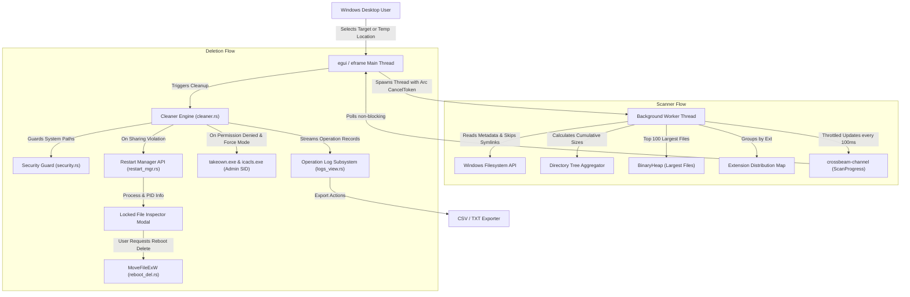

# Project Codebase Map: Windows Folder Analyzer & Advanced Cleaner (`win-folder-cleaner`)

## 1. Directory Tree & Component Index

```text
win-folder-cleaner/
├── Cargo.toml                       # Project manifest with eframe, windows, rayon, crossbeam-channel, rfd
├── README.md                        # User and developer documentation with build and usage instructions
├── CHANGELOG.md                     # Living changelog following Keep a Changelog conventions
├── PROJECT_MAP.md                   # This living architectural codebase map
├── src/
│   ├── lib.rs                       # Library entrypoint exposing core engine and UI subsystems
│   ├── main.rs                      # Native Windows GUI bootstrap, viewport configuration, and execution entry
│   ├── core/                        # Headless, zero-UI business logic adhering to SOLID principles
│   │   ├── mod.rs                   # Re-exports core modules
│   │   ├── types.rs                 # Central domain models (FileInfo, DirScanSummary, TempLocation, LogEntry, etc.)
│   │   ├── security.rs              # Token elevation check, runas relauncher, protected system paths guard, ACL/takeown
│   │   ├── restart_mgr.rs           # Windows Restart Manager API integration for detecting file-locking processes
│   │   ├── reboot_del.rs            # Win32 MoveFileExW wrapper with MOVEFILE_DELAY_UNTIL_REBOOT
│   │   ├── temp_dirs.rs             # System & user temp location discovery (C:\Windows\Temp, %TEMP%, AppData, Profiles)
│   │   ├── analyzer.rs              # On-demand deeper expansion scanner, strict size-sorting, Rayon parallelism, low-memory bounds
│   │   └── cleaner.rs               # Safe deletion engine, content-only root retention, force-delete, and dry-run
│   └── ui/                          # Native desktop graphical user interface using egui & eframe
│       ├── mod.rs                   # Re-exports UI views, theme, and application state
│       ├── theme.rs                 # Unslop/Impeccable dark theme implementation (neutral ramp, quiet chrome, 4px grid)
│       ├── app.rs                   # Main eframe::App loop, classic menu bar, status bar, background worker channel orchestration
│       ├── chart_view.rs            # Interactive vector Pie Chart with hover callout tooltips, exploded slices, and bar breakdown
│       ├── explorer_view.rs         # Pro 4-Quadrant view: Folder tree, contents table, logical drives table, interactive chart
│       ├── dashboard_view.rs        # System overview, privilege badge, aggregated stat cards, and quick action shortcuts
│       ├── cleaner_view.rs          # Multi-location temp selector, age threshold filter, takeown/icacls/clean buttons
│       ├── logs_view.rs             # Operations audit log table, status filtering, RFC 4180 CSV export, and TXT export
│       └── modals.rs                # Confirmation dialogs (delete confirmation with dry-run toggle, locked file inspector)
└── tests/
    ├── path_validation_test.rs      # Unit tests for critical system path protection and traversal denial
    ├── scanner_test.rs              # Integration tests for recursive file scanner accuracy and cancellation tokens
    └── cleaner_test.rs              # Integration tests for dry-run simulation, root folder retention, and readonly deletion
```

---

## 2. Data & Telemetry Flow



---

## 3. Operations & Internal Action Catalog

| Operation Name | Invocation Module | Authentication / Privileges | Description / Side Effects |
| :--- | :--- | :--- | :--- |
| `is_elevated` | `core::security` | Any Token | Queries Process Token Elevation via Win32 `GetTokenInformation`. |
| `relaunch_as_admin` | `core::security` | Standard User -> Admin | Invokes `ShellExecuteExW` with verb `runas` to elevate while preserving arguments. |
| `is_critical_system_path` | `core::security` | None | Validates paths against canonical Windows protected roots (`C:\Windows`, `System32`, `Program Files`, etc.). |
| `scan_directory_tree` | `core::analyzer` | Read Permissions | Root & Level 1 fast scan with strict descending size sorting and candidate bounds. |
| `scan_deeper_level_for_node` | `core::analyzer` | Read Permissions | Scans deeper levels on-demand exclusively for folders expanded by clicking, sorting children by size. |
| `load_directory_files` | `core::analyzer` | Read Permissions | Reads immediate files for a single directory on demand (< 1ms), avoiding full disk file caching. |
| `clean_directory_contents` | `core::cleaner` | Write Permissions | Deletes contents of a folder recursively while strictly preserving the root directory itself. |
| `take_ownership` | `core::security` | Elevated Admin | Executes `takeown /F "<path>" /A /R /D Y` without shell or PowerShell wrappers. |
| `grant_administrators_acl`| `core::security` | Elevated Admin | Executes `icacls "<path>" /grant *S-1-5-32-544:(OI)(CI)F /T /C` preserving other ACLs. |
| `get_locking_processes` | `core::restart_mgr` | Any | Connects to Windows Restart Manager session to identify processes holding file locks. |
| `schedule_deletion_on_reboot` | `core::reboot_del`| Elevated Admin | Registers path with `MoveFileExW` (`MOVEFILE_DELAY_UNTIL_REBOOT`) in Windows Session Manager. |

---

## 4. In-Memory Domain Models & Schema Map

### Domain Structures (`src/core/types.rs`)

1. **`FileInfo`**:
   - `path: PathBuf` - Normalized target filesystem path.
   - `name: String` - File basename.
   - `extension: String` - Normalized lowercase extension or `(no extension)`.
   - `size: u64` - File length in bytes.
   - `modified: Option<SystemTime>` - Timestamp of last filesystem modification.
   - `is_readonly: bool` - Whether file has read-only attribute set.
   - `is_locked: bool` - Whether file is held by an active process lock.
   - `is_inaccessible: bool` - Whether permission was denied during inspection.

2. **`DirScanSummary`**:
   - `root_path: PathBuf`, `total_bytes: u64`, `accessible_bytes: u64`, `inaccessible_bytes: u64`.
   - `total_files: usize`, `total_dirs: usize`, `inaccessible_files: usize`.
   - `largest_files: Vec<FileInfo>`, `largest_subdirs: Vec<DirEntrySummary>`.
   - `extensions: Vec<ExtensionStat>`, `duration_ms: u128`.

3. **`FolderTreeNode`**:
   - `path: PathBuf` - Normalized directory path.
   - `name: String` - Folder display name.
   - `total_size: u64` - Cumulative recursive subtree byte size.
   - `immediate_files_size: u64` - Sum of direct file sizes inside this directory.
   - `file_count: usize` - Recursive total files under this node.
   - `dir_count: usize` - Recursive total subfolders under this node.
   - `children: Vec<FolderTreeNode>` - Child folders sorted descending by total size.
   - `direct_files: Vec<FileInfo>` - Immediate files list for folder inspection.

4. **`TempLocation`**:
   - `id: String`, `name: String`, `path: PathBuf`, `description: String`.
   - `is_system: bool`, `exists: bool`, `selected: bool`.
   - `summary: Option<DirScanSummary>`, `locked_files: Vec<FileInfo>`.

4. **`LogEntry`**:
   - `timestamp: DateTime<Local>`, `target_path: String`, `action: String`.
   - `status: LogStatus` (`Success`, `Warning`, `Error`, `DryRun`, `Skipped`).
   - `details: String`.

---

## 5. Frontend & View Layout Catalog

- **Classic Top Menu Bar (`pro_menu_bar`)**:
  - `File`: Browse folder to scan, refresh logical drives, relaunch elevated, exit.
  - `Scan`: Start scan, stop scan.
  - `Clean`: Switch to Temp Cleaner suite.
  - `View`: Folder Size Analyzer (Pro), Temp Cleaner, Operation Log, Dashboard.
  - `Help`: About Folder Size Pro.
  - `badge_privilege`: Shows `Elevated (Admin)` in green or `Standard User` in amber with relaunch action.
- **Top Navigation Bar (`app_top_bar`)**:
  - `tab_1`: **Folder Size Analyzer (Pro)** (Default startup view matching Folder Size Professional 4-quadrant layout).
  - `tab_2`: **Temp Cleaner** (Multi-location checkboxes, age filter dropdown, administrative operations).
  - `tab_3`: **Operation Log** (Audited action table, search box, status dropdown, CSV/TXT export).
  - `tab_0`: **Dashboard** (System health, privilege level, aggregated metrics, quick links).
- **Pro 4-Quadrant View (`tab_1` - `explorer_view.rs`)**:
  - **Toolbar**: Drive dropdown, path input, browse button, scan/stop, refresh, and size unit selectors (`B`, `KB`, `MB`, `GB`, `AUTO`).
  - **Top-Left**: Directory tree view (`Folder` | `Size`) with recursive expander (`▶` / `▼`) and cumulative subtree sizes.
  - **Top-Right**: Contents table (`Name`, `Size`, `Percent` progress bar, `Files`, `Folders`, `Attributes`, and contextual cleanup/inspect actions).
  - **Bottom-Left**: Logical Drives table (`Drive`, `Total Size`, `Used Space`, `Free Space`, `Usage %`).
  - **Bottom-Right**: Interactive vector Pie Chart (`chart_view.rs`) with exploded slice on hover, callout tooltips (`Name: XX.XX% (XX.XX MB)`), and toggle to Bar breakdown.
- **Bottom Status Bar (`app_status_bar`)**:
  - Real-time status (`Idle` / `Scanning: ...`), `X Files, Y Folders`, formatted total size, and progress indicator.
- **Modals**:
  - `modal_delete_confirm`: Modal dialog with dry-run toggle, itemized file/size summary, and force-delete options.
  - `modal_locked_inspector`: Displays locking process name (e.g. `chrome.exe`, `explorer.exe`), PID, service name, and one-click "Schedule Delete on Reboot" trigger.
